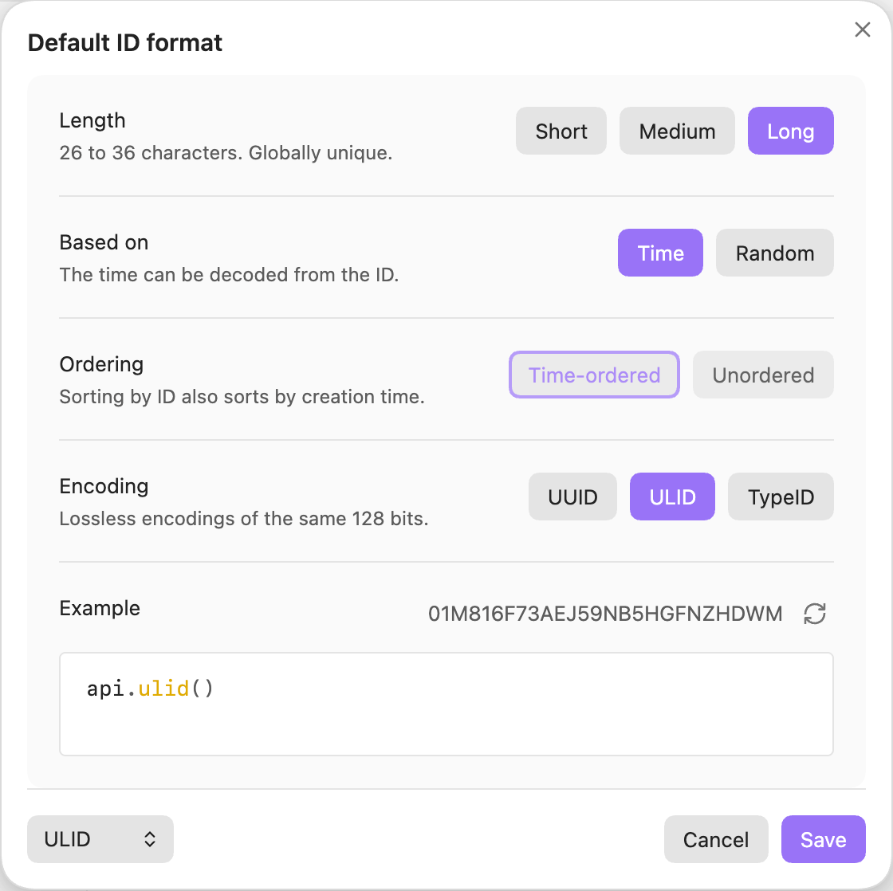
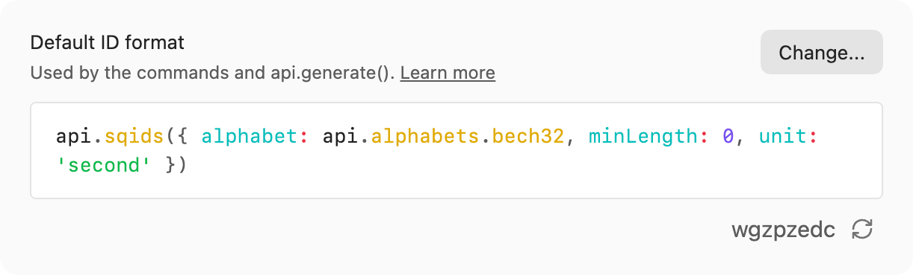

# Unique ID Generator

Generate unique IDs in Obsidian, from short 7-character IDs to 128-bit ones: base36, Sqids, NanoID, UUID v4/v7, ULID and TypeID.

- Insert an ID at the cursor or copy it to the clipboard with a command.
- Choose the default format with a guide that compares length, what the ID is based on, and ordering.
- Call any format from Templater or your own scripts, with its own options.
- Works on desktop and mobile, and makes no network requests.



## Commands

| Command              | What it does                                                                   |
| -------------------- | ------------------------------------------------------------------------------ |
| Copy ID to clipboard | Copies a new ID in the default format.                                         |
| Insert ID            | Inserts a new ID in the default format at the cursor, replacing any selection. |

No hotkeys are set by default. To assign them, search for Unique ID Generator in **Settings → Hotkeys**.

## Settings

**Default ID format** sets the format that the commands and `api.generate()` use. The default is Sqids. The settings tab shows the call that gives the same result and an example ID.



To choose another format, select **Change...**:

- Choose by length, what the ID is based on, and ordering. [Formats](#formats) compares them. For long time-based IDs, also choose the encoding: UUID, ULID or TypeID. For TypeID, enter the type prefix.
- Or pick a format by name from the list next to **Save**.
- The example ID and the equivalent call update as you choose. Select ↻ for another example.

Nothing is saved until you select **Save**.

## Formats

| Format  | Example                                | Characters         | Based on            | Ordering     | Uniqueness          |
| ------- | -------------------------------------- | ------------------ | ------------------- | ------------ | ------------------- |
| base36  | `0tow7fd`                              | 7                  | Time (seconds)      | Time-ordered | Locally unique      |
| Sqids   | `zfgagxzt`                             | 8                  | Time (seconds)      | Unordered    | Locally unique      |
| NanoID  | `zurkwxrrs9erl2nz`                     | 16                 | Random              | Unordered    | Collision-resistant |
| UUID v7 | `01a20227-feae-72c1-8ab2-07e39fe40e97` | 36                 | Time (milliseconds) | Time-ordered | Globally unique     |
| ULID    | `01M812FZNEEB0RNCGAPH7GY6ZD`           | 26                 | Time (milliseconds) | Time-ordered | Globally unique     |
| TypeID  | `task_01m812fzneeb0rncgaph7gy6zd`      | 26, or prefix + 27 | Time (milliseconds) | Time-ordered | Globally unique     |
| UUID v4 | `32a1d463-7e1c-4403-a917-cc1d87a2f48f` | 36                 | Random              | Unordered    | Globally unique     |

Ordering:

- Time-ordered IDs sort in the order they were created, so sorting notes or rows by ID also sorts them by creation time.
- Unordered IDs look unrelated even when made one after another.

Uniqueness:

- Locally unique IDs never repeat in the same vault on the device that makes them.
- Collision-resistant IDs are 16 random characters (80 bits), so a million of them repeat with a probability of about 4 × 10⁻¹³.
- Globally unique IDs are 128 bits and in practice never repeat anywhere.

base36 and Sqids IDs are made from the current second. When two are made in the same second, the plugin adds 1 to the later one, and the commands and all API functions share this counter. The counter is saved on the device for each vault, so it continues after the plugin is reloaded or Obsidian restarts. Another device keeps its own counter, so two devices that make one in the same second can produce the same ID. If you create IDs on several synced devices, use a collision-resistant or globally unique format.

UUID v7, ULID and TypeID hold the same 128 bits in different encodings: hexadecimal, uppercase Crockford base32, and lowercase Crockford base32 after a type prefix. You can convert one into another without losing anything.

> [!NOTE]
> **Time-based IDs reveal when they were made.** base36, Sqids, UUID v7, ULID and TypeID can all be decoded back to the time they were created. Sqids only looks scrambled; it is not encryption. If the creation time must stay private, use NanoID or UUID v4. See [Decoding the time](#decoding-the-time).

## Use in scripts

The API is on the plugin object:

```js
app.plugins.plugins['unique-id-generator'].api
```

### Templater

```
<%* const idgen = app.plugins.plugins['unique-id-generator'].api -%>
---
id: <% idgen.generate() %>
task: <% idgen.typeid({ prefix: 'task' }) %>
---
```

To add a prefix to any format, join it yourself:

```
<% 'TASK-' + idgen.generate() %>
```

### API

`generate()` makes an ID in the default format. Each format also has its own function, which ignores the settings and takes options:

| Function          | Options and defaults                                               | Example                           |
| ----------------- | ------------------------------------------------------------------ | --------------------------------- |
| `generate()`      | None                                                               | `zfgagxzt`                        |
| `base36(options)` | `unit: 'second'`                                                   | `0tow7fd`                         |
| `sqids(options)`  | `alphabet: api.alphabets.bech32`, `minLength: 0`, `unit: 'second'` | `zfgagxzt`                        |
| `nanoid(options)` | `alphabet: api.alphabets.bech32`, `size: 16`                       | `zurkwxrrs9erl2nz`                |
| `uuidv4()`        | None                                                               | `32a1d463-7e1c-…`                 |
| `uuidv7()`        | None                                                               | `01a20227-feae-…`                 |
| `ulid()`          | None                                                               | `01M812FZNEEB0RNCGAPH7GY6ZD`      |
| `typeid(options)` | `prefix: ''`                                                       | `task_01m812fzneeb0rncgaph7gy6zd` |

Every option can be left out. For example:

```js
const api = app.plugins.plugins['unique-id-generator'].api
api.base36({ unit: 'millisecond' }) // e.g. 0mwrimawd
api.sqids({ alphabet: api.alphabets.crockford, minLength: 10 })
api.nanoid({ alphabet: '0123456789abcdef', size: 12 })
api.typeid({ prefix: 'user' })
```

Options:

- `unit`: `'second'` or `'millisecond'`, for `base36` and `sqids`. base36 pads seconds to 7 digits and milliseconds to 9, so the IDs sort correctly until the year 4453 and 5188 respectively.
- `alphabet`: a string of 2 to 256 distinct characters, for `sqids` and `nanoid`. Emoji and other characters outside the Basic Multilingual Plane are not allowed, and Sqids needs at least 3 ASCII characters. `api.alphabets` has three:

  | Name        | Characters                         | Notes                                         |
  | ----------- | ---------------------------------- | --------------------------------------------- |
  | `bech32`    | `qpzry9x8gf2tvdw0s3jn54khce6mua7l` | Lowercase, without the look-alikes `1 b i o`  |
  | `crockford` | `0123456789abcdefghjkmnpqrstvwxyz` | Lowercase Crockford base32, without `i l o u` |
  | `rfc4648`   | `ABCDEFGHIJKLMNOPQRSTUVWXYZ234567` | RFC 4648 base32                               |

- `minLength`: the shortest ID `sqids` makes, from 0 to 255. With the default 0, IDs are as long as the number needs.
- `size`: the number of characters `nanoid` makes, from 1 to 1024.
- `prefix`: the TypeID type prefix, up to 63 lowercase letters and underscores, starting and ending with a letter. The function adds the separator `_`, and leaves it out when the prefix is empty.

To change the case of an ID, call `toUpperCase()` or `toLowerCase()` on it.

An unknown or misspelled option, an invalid value, or an argument to a function that takes none throws an error that names the function. Because of the last rule, pass a function to callbacks instead of the API function itself: to make several IDs at once, write `Array.from({ length: 3 }, () => api.ulid())`, not `[1, 2, 3].map(api.ulid)`.

## Decoding the time

| Format  | How to get the time back                                                                                                       |
| ------- | ------------------------------------------------------------------------------------------------------------------------------ |
| base36  | `new Date(parseInt(id, 36) * 1000)`. Leave out `* 1000` if you used `unit: 'millisecond'`.                                     |
| Sqids   | `new Date(new Sqids({ alphabet }).decode(id)[0] * 1000)` with any [Sqids](https://sqids.org) library, using the same alphabet. |
| UUID v7 | `new Date(parseInt(id.replace(/-/g, '').slice(0, 12), 16))`                                                                    |
| ULID    | `new Date(decodeTime(id))` with any ULID library.                                                                              |
| TypeID  | Remove the prefix and `_`, then decode the rest as a ULID.                                                                     |

Because the plugin adds 1 for each extra ID made in the same second, the decoded time can be later than the real one by that many seconds.

## Installation

Requires Obsidian 1.13.1 or later.

Once the plugin is listed in the community directory:

1. Open **Settings → Community plugins**, and turn off restricted mode if it is on.
2. Select **Browse** and search for Unique ID Generator.
3. Install and enable it.

Manually:

1. Download `main.js`, `manifest.json` and `styles.css` from the [latest release](https://github.com/cojiso/obsidian-unique-id-generator/releases/latest).
2. Put them in `.obsidian/plugins/unique-id-generator/` in your vault.
3. Reload Obsidian and enable the plugin in **Settings → Community plugins**.

## License

[MIT](LICENSE)

This plugin bundles the following libraries, all under the MIT license. Their copyright notices and the license text are included at the end of `main.js`.

- [sqids](https://github.com/sqids/sqids-javascript)
- [uuid](https://github.com/uuidjs/uuid)
- [nanoid](https://github.com/ai/nanoid)
- [ulid](https://github.com/ulid/javascript)

The TypeID test data in `test/fixtures/typeid` comes from the [TypeID specification](https://github.com/jetify-com/typeid) under the Apache License 2.0.
